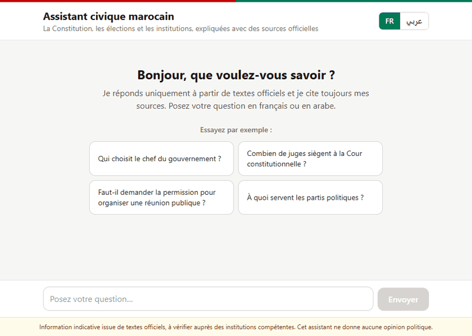
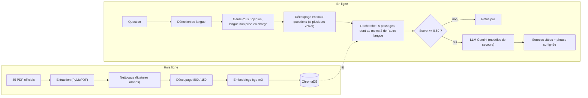
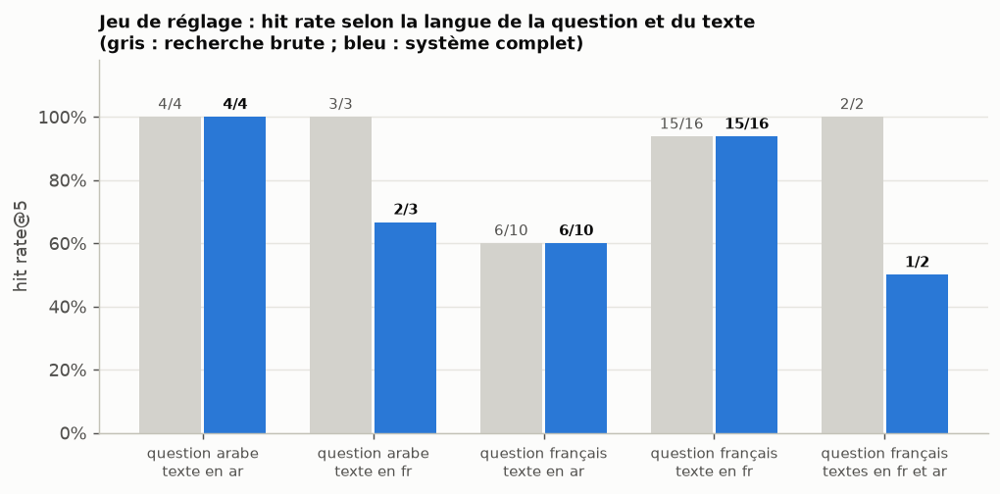
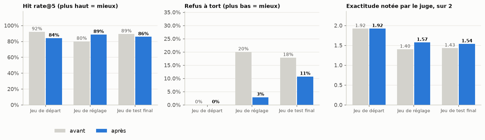
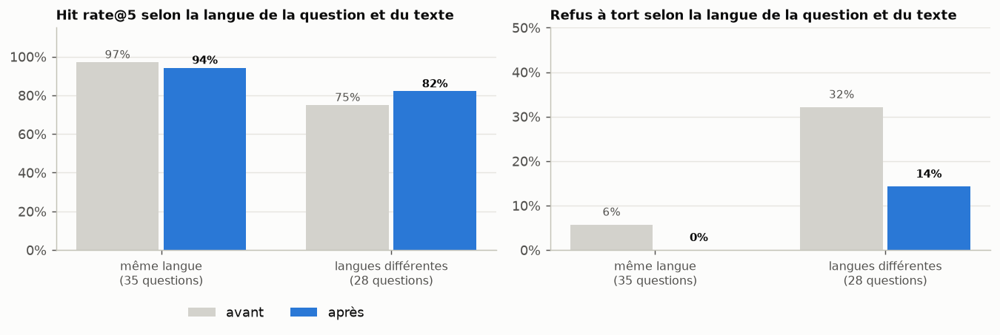
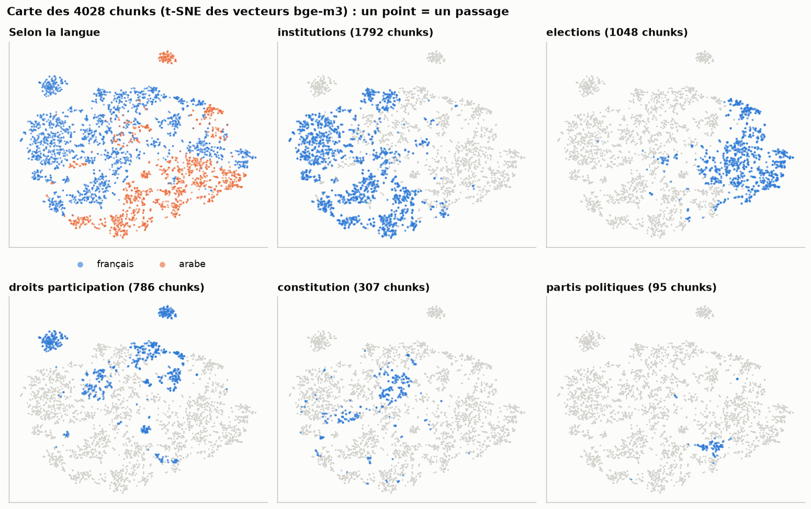
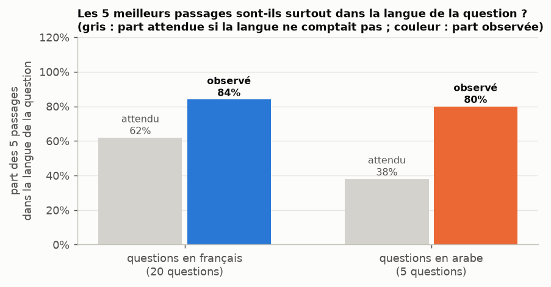
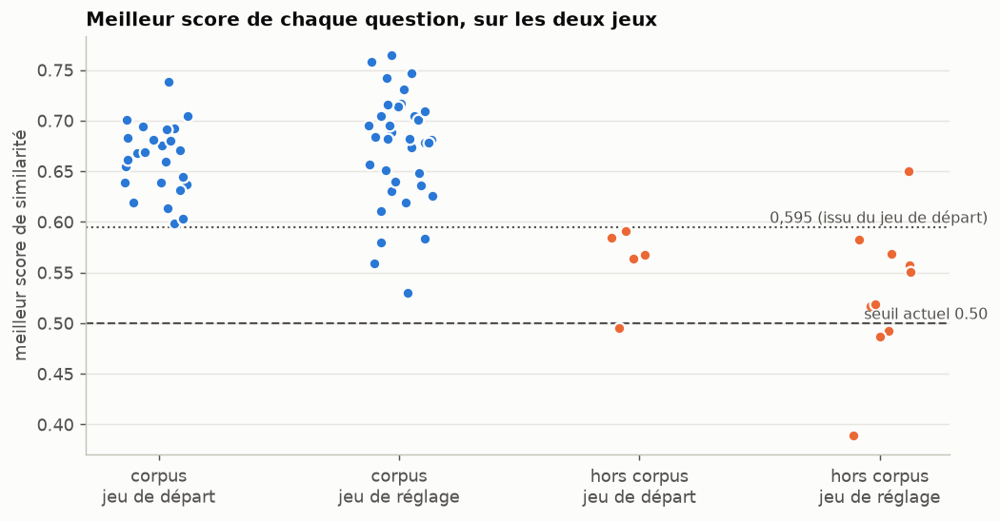
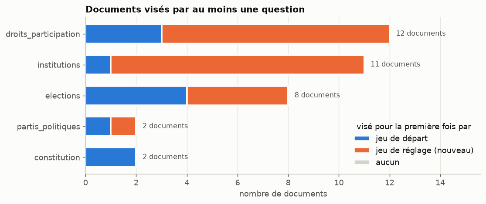

# Assistant civique marocain

[](https://github.com/salmahanabal/Moroccan-civic-assistant/actions/workflows/ci.yml)

Un chatbot **bilingue (français / arabe)** qui répond aux questions sur la **Constitution, les élections, les partis politiques et les institutions du Maroc**, uniquement à partir de **35 textes officiels**. Chaque réponse cite ses sources (document, page, extrait avec la phrase pertinente surlignée, lien d'origine). L'assistant reste **strictement neutre** : il explique ce que disent les textes, jamais pour qui voter, et il dit « je ne sais pas » quand la réponse n'est pas dans les documents.

Le pipeline RAG (*Retrieval-Augmented Generation*) est **écrit à la main**, sans LangChain, une fonction par étape. Le projet inclut une **évaluation chiffrée** (trois jeux de questions qui couvrent les 35 documents, dont un test final jamais utilisé pour régler le système ; notation manuelle ; juge LLM validé par un coefficient kappa ; analyse exploratoire des embeddings) et reconnaît ses limites : des corrections ont réduit les refus à tort, et l'écart de fiabilité selon la langue du texte (un peu moindre quand la question et le texte ne sont pas dans la même langue) est mesuré et documenté.

Projet de portfolio en data science / IA. Auteure : [@salmahanabal](https://github.com/salmahanabal).

## Sommaire

- [Démo](#démo)
- [Résultats en un coup d'œil](#résultats-en-un-coup-dœil)
- [Fonctionnalités](#fonctionnalités)
- [Architecture](#architecture)
- [Choix techniques et justifications](#choix-techniques-et-justifications)
- [Corpus](#corpus)
- [Évaluation](#évaluation)
- [Installation et lancement](#installation-et-lancement)
- [API](#api)
- [Structure du dépôt](#structure-du-dépôt)
- [Qualité, tests et intégration continue](#qualité-tests-et-intégration-continue)
- [Limites et pistes d'amélioration](#limites-et-pistes-damélioration)
- [Confidentialité, avertissement et sources](#confidentialité-avertissement-et-sources)

## Démo



[Voir la vidéo en vitesse réelle (WebM, 5,4 Mo)](docs/demo/demo_surlignage_natif.webm) · durée : environ 42 secondes dans le GIF.

Ce que montre la démo :

1. **Une question en français** (« Qui choisit le chef du gouvernement ? ») reçoit une réponse avec ses sources numérotées.
2. **Un clic déplie la source** : l'application affiche la phrase du passage qui répond (ici l'article 47 de la Constitution) et la surligne.
3. **« Ouvrir le document »** mène au site officiel de la Chambre des représentants, où l'on retrouve l'article cité.
4. **Le passage en arabe** retourne l'interface de droite à gauche, et la question arabe reçoit une réponse avec ses sources.
5. **Une question d'opinion** (« Pour quel parti dois-je voter ? ») reçoit un refus poli et neutre.

À propos de l'enregistrement : les surlignages sont ceux de l'application (voir [`SourceCard.jsx`](frontend/src/components/SourceCard.jsx)) et celui du navigateur sur le site officiel ; les questions sont tapées par un script et les bandeaux de texte sont ajoutés pour expliquer.

**Le projet n'est pas hébergé publiquement** : la démo a été enregistrée sur une exécution locale. La section [Installation et lancement](#installation-et-lancement) explique comment la reproduire.

## Résultats en un coup d'œil

Configuration finale (35 documents, `BAAI/bge-m3`, minimum de 2 passages de l'autre langue, découpage des questions à plusieurs volets, consigne corrigée), mesurée sur **trois jeux de questions, avant et après les corrections** décrites [plus bas](#corrections-apportées-et-test-final). Le tableau est produit par `python -m evaluation.compare_runs` : chaque chiffre vient des fichiers de résultats. L'exactitude et la fidélité sont celles du **juge LLM** pour les trois jeux, afin de comparer « avant » et « après » sur le même pied (la notation manuelle du jeu de départ, 1,92 / 2, concerne l'ancien système et reste dans [`results.csv`](backend/evaluation/results.csv)).

Les trois lots de questions : le **jeu de départ** (30 questions écrites au début du projet), le **jeu de réglage** (45 questions sur les documents que le premier ignorait) et le **jeu de test final** (36 questions écrites avant toute correction, jamais utilisées pour corriger le système). Chaque question a sa réponse attendue (fichiers `questions.csv`, `questions_set2.csv`, `questions_set3.csv`).

| Jeu | Système | Hit rate@5 | Refus correct (hors corpus) | Refus à tort (corpus) | Exactitude (juge) | Fidélité (juge) | Latence |
|---|---|---|---|---|---|---|---|
| Jeu de départ (30 questions) | avant | 92 % (23/25) | 100 % (5/5) | 0 % (0/25) | 1.92 / 2 | 100 % (30/30) | 10.0 s |
| Jeu de départ (30 questions) | après | 84 % (21/25) | 100 % (5/5) | 0 % (0/25) | 1.92 / 2 | 100 % (30/30) | 3.6 s |
| Jeu de réglage (45 questions) | avant | 80 % (28/35) | 100 % (10/10) | 20 % (7/35) | 1.40 / 2 | 98 % (44/45) | 3.1 s |
| Jeu de réglage (45 questions) | après | 89 % (31/35) | 100 % (10/10) | 3 % (1/35) | 1.57 / 2 | 100 % (45/45) | 2.5 s |
| Jeu de test final (36 questions) | avant | 89 % (25/28) | 100 % (8/8) | 18 % (5/28) | 1.43 / 2 | 100 % (36/36) | 4.8 s |
| Jeu de test final (36 questions) | après | 86 % (24/28) | 100 % (8/8) | 11 % (3/28) | 1.54 / 2 | 100 % (36/36) | 3.0 s |

Les jeux de départ et de réglage ont servi à **régler** les corrections (le jeu de départ est celui sur lequel l'ancien système avait déjà été réglé). Le jeu de test final, écrit avant toute correction et mesuré une seule fois avec le système corrigé, est le **test final**.

**Ce qu'il faut en retenir :**

- **Les refus à tort baissent** (le système répondait « pas dans mes documents » alors que la réponse existe) : 20 % → 3 % sur le jeu de réglage, et **18 % → 11 % sur le test final** (5 → 3 questions sur 28).
- **L'exactitude notée par le juge monte un peu** : 1,40 → 1,57 (jeu de réglage) et **1,43 → 1,54 sur le test final** ; elle ne bouge pas sur le jeu de départ.
- **Aucune invention nouvelle** : les 23 questions hors corpus des trois jeux sont toujours refusées (100 %) et la fidélité reste à 100 % sauf une réponse du jeu de réglage avant correction.
- **La recherche ne s'améliore pas de façon fiable** : hit rate@5 en hausse sur le jeu de réglage (80 % → 89 %), en légère baisse sur le test final (89 % → 86 %, une question) et sur le jeu de départ (92 % → 84 %).
- **Le système répond dans la langue de la question quelle que soit la langue du texte** (24 des 28 questions qui croisent les langues obtiennent une réponse), avec une fiabilité un peu moindre quand les deux langues diffèrent : [écart mesuré](#corrections-apportées-et-test-final).

Tout cela porte sur de petits jeux (28 à 35 questions du corpus chacun) : un écart d'une ou deux questions est dans le bruit. Les latences sont mesurées des jours différents sur un service gratuit dont la charge varie : elles ne sont pas comparables entre elles.

## Fonctionnalités

- **Questions en français et en arabe**, y compris quand le texte officiel n'existe que dans l'autre langue (réponse dans la langue de la question).
- **Sources vérifiables** : seuls les passages réellement cités par la réponse sont affichés, avec fichier, page, lien d'origine (les PDF s'ouvrent directement à la page citée) et la **phrase qui répond surlignée**.
- **Neutralité** : refus des demandes d'avis ou de conseil de vote, détectées avant tout appel au modèle (français et arabe) puis par une consigne stricte au LLM.
- **Refus honnête** : si aucun passage n'est assez proche ou si le modèle ne trouve pas la réponse, l'assistant le dit au lieu d'inventer.
- **Questions à plusieurs volets** (« Comment sont choisis les députés, et qui devient chef du gouvernement ? ») : la question est découpée en sous-questions pour la recherche.
- **Interface React** adaptée à l'ordinateur et au téléphone, avec affichage de droite à gauche pour l'arabe, exemples de questions et avertissement toujours visible.
- **API FastAPI** documentée (`/docs`), avec limitation de requêtes par adresse IP et CORS restreint.
- **Confidentialité** : le texte des questions n'est jamais écrit dans les journaux.

## Architecture



### Chaîne hors ligne (construction de l'index)

1. **Extraction** ([`ingest.py`](backend/src/ingest.py)) : texte de chaque page avec PyMuPDF, enrichi des métadonnées du registre [`data/sources.csv`](data/sources.csv) (thème, langue, organisme, lien).
2. **Nettoyage** ([`cleaning.py`](backend/src/cleaning.py)) : suppression du bruit, et **réparation des ligatures arabes** enregistrées à l'envers par certains PDF, en prenant comme vocabulaire de référence le texte sain de la Constitution.
3. **Découpage** ([`chunking.py`](backend/src/chunking.py)) : chunks de 800 caractères avec 150 de chevauchement, soit 4 028 chunks pour 1 293 pages.
4. **Embeddings** ([`embeddings.py`](backend/src/embeddings.py)) : `BAAI/bge-m3` (vecteurs de 1 024 dimensions, multilingues), sur carte graphique en demi-précision si elle est disponible, sur processeur sinon.
5. **Stockage** ([`vectorstore.py`](backend/src/vectorstore.py)) : ChromaDB persistant, similarité cosinus.

### Chaîne en ligne (une question)

1. **Langue et garde-fous** ([`language.py`](backend/src/language.py), [`guards.py`](backend/src/guards.py)) : détection de la langue, refus immédiat des demandes d'avis politique et des questions dans une langue non prise en charge (l'anglais). Aucun appel au LLM, donc aucun quota consommé.
2. **Découpage de la question** ([`query_rewriter.py`](backend/src/query_rewriter.py)) : si la question semble porter sur plusieurs sujets, le LLM la scinde en questions autonomes, utilisées **seulement pour la recherche**. Appel limité à 8 s ; en cas de lenteur ou de panne, la recherche classique prend le relais.
3. **Recherche** ([`retriever.py`](backend/src/retriever.py)) : les 5 meilleurs passages, avec un **minimum garanti de 2 passages de l'autre langue** : si les meilleurs passages sont tous dans la langue de la question, les meilleurs passages de l'autre langue prennent la place des derniers ; s'ils sont déjà nombreux, rien n'est plafonné. Pour les sous-questions, les résultats sont mélangés un à tour de rôle en conservant ce minimum.
4. **Seuil de refus** : si aucun passage n'atteint un score de 0,50, l'assistant refuse sans appeler le LLM.
5. **Génération** ([`generator.py`](backend/src/generator.py), [`prompts.py`](backend/src/prompts.py)) : appel REST à Gemini, avec essai automatique d'un autre modèle en cas de quota ou de panne. La consigne impose de ne répondre qu'avec les extraits, de les citer ([1], [2]…), de rester neutre et de traiter les extraits comme des données, pas comme des ordres. Elle demande aussi de lire attentivement les extraits écrits dans l'autre langue, et de répondre à la partie de la question qui trouve réponse (en disant ce qui manque) plutôt que de refuser en bloc.
6. **Sources** ([`rag.py`](backend/src/rag.py), [`excerpt.py`](backend/src/excerpt.py)) : on ne garde que les passages cités. Pour chacun, on choisit **la phrase qui partage le plus de mots (et de nombres) avec la réponse et la question**, et l'interface la surligne. Quand aucun mot n'est commun (réponse en français citant un texte arabe), on ne devine pas : on montre le début du passage, sans surlignage. Si la phrase surlignée commence par « Ils », « Ce »…, la phrase précédente du même passage est montrée avant elle. Pour un PDF, le lien est complété par `#page=N` : le document s'ouvre à la page citée.

### Technologies

| Couche | Technologie |
|---|---|
| Extraction, nettoyage | PyMuPDF, expressions régulières, réparation des ligatures arabes |
| Embeddings | `sentence-transformers`, `BAAI/bge-m3` (local) |
| Base vectorielle | ChromaDB (persistante, cosinus) |
| Génération | API Gemini (Google) appelée en REST avec la bibliothèque standard, liste de modèles de secours dans [`config.py`](backend/src/config.py) |
| API | FastAPI, Pydantic, slowapi (10 requêtes par minute et par IP), CORS configurable |
| Interface | React 19, Vite, Tailwind CSS 4, affichage de droite à gauche pour l'arabe |
| Qualité | pytest (171 tests), GitHub Actions (backend, frontend, Docker), notebook d'analyse |
| Déploiement | Docker (PyTorch en version processeur), docker compose |

## Choix techniques et justifications

Les chiffres viennent des fichiers de résultats ([`python -m evaluation.report`](backend/evaluation/report.py)).

- **`bge-m3` plutôt que `multilingual-e5-base`.** Avec le même découpage (800/150) sur 17 documents, le hit rate@5 passe de 72 % (18/25) à 84 % (21/25). Le modèle est multilingue et gère mieux l'arabe.
- **Découpage 800 / 150.** Avec `e5-base`, des chunks de 1 200 caractères (recouvrement 200) donnaient 76 % contre 72 % pour 800/150. Cette taille n'a pas été testée avec `bge-m3` : c'est une piste ouverte.
- **Minimum de passages de l'autre langue.** Un modèle multilingue préfère les textes écrits dans la langue de la question, or de nombreuses lois n'existent qu'en arabe. Sur 35 documents, réserver 2 places sur 5 fait passer le hit rate@5 de 76 % (19/25) à 84 % (21/25) ; 3 places donnent le même résultat. Sur 17 documents avec `e5-base`, 2 places donnent 76 %, 3 places 80 %, contre 72 % sans réservation. **Correction après le jeu de réglage** : ces places formaient un plafond (3 passages de la langue de la question et exactement 2 de l'autre) et non un minimum, ce qui écartait un bon texte quand il n'était que le 3e meilleur de l'autre langue, et le mélange des sous-questions les perdait ; elles sont maintenant un minimum garanti (voir [les corrections](#corrections-apportées-et-test-final)).
- **Découpage des questions à plusieurs volets.** Le vecteur d'une question à deux sujets est un mélange qui ressemble mal à chacun : les bons passages arrivaient loin dans le classement (rang médian 34 pour ces questions, voir l'[analyse exploratoire](#analyse-exploratoire)). Avec le découpage, les questions combinées passent de 2/5 à 4/5 et le hit rate@5 global de 84 % à 92 % (23/25). Les variantes essayées puis écartées (passer à 8 passages, limiter à 2 passages par document, ajouter la traduction de la question) ne corrigeaient pas les questions manquées ou en faisaient perdre une. Ce gain est indicatif : ces mêmes questions ont servi à diagnostiquer et à mesurer. **Sur le jeu de réglage (neuf), cet avantage n'apparaissait pas avant la correction du plafond** (recherche brute 30/35, système complet 28/35) ; sans le découpage, après correction du plafond, le jeu de départ tombe à 20/25 alors que le jeu de réglage ne change pas (31/35), donc le découpage est conservé.
- **Seuil de refus bas (0,50) + deuxième filet par le LLM.** Le seuil évite les refus à tort (aucune des 60 questions du corpus des deux jeux n'est sous 0,50), et c'est surtout le LLM qui refuse les questions hors sujet : 15 refus corrects sur 15, alors que le seuil seul n'en arrêterait que 4 (voir l'[analyse exploratoire](#analyse-exploratoire)).
- **Garde-fous avant le LLM.** Refuser un avis politique par des règles précises (français et arabe) est plus fiable, plus rapide et gratuit ; la consigne du LLM reste une deuxième ligne de défense.
- **Gemini en REST avec modèles de secours.** Le palier gratuit est limité par modèle et par jour ; l'appel direct avec délai maximal est plus prévisible que le SDK, qui bloquait sans message clair.
- **Calcul de l'index sur carte graphique** (demi-précision, indispensable pour tenir dans 4 Go) : 4 028 chunks en 1 603 s (environ 27 minutes) sur une NVIDIA GeForce GTX 1650. Sur processeur, le calcul de 2 049 chunks avec le modèle plus petit `e5-base` avait pris 2 125 s : les deux mesures ne portent pas sur le même modèle, elles montrent seulement l'ordre de grandeur.
- **Pas de LangChain** : pour comprendre et pouvoir expliquer chaque étape, y compris quand elle échoue.

## Corpus

**35 documents officiels** (20 en français, 15 en arabe), collectés entre le 18 et le 25 octobre 2026. Les 4 028 chunks se répartissent en 62 % de français et 38 % d'arabe.

| Thème | Documents (FR / AR) | Contenu |
|---|---|---|
| Constitution | 2 (1 / 1) | Constitution de 2011 |
| Élections | 8 (2 / 6) | lois organiques 27-11 (Chambre des représentants, FR et AR), 28-11 (Chambre des conseillers) et 59-11 (collectivités territoriales) ; loi 57-11 sur les listes électorales (FR consolidée et AR) et loi 55-25 qui la modifie ; arrêté sur le site des listes électorales |
| Partis politiques | 2 (0 / 2) | loi organique 29-11, décret sur le financement des partis |
| Institutions | 11 (9 / 2) | lois organiques sur les préfectures et provinces (112-14), les communes (113-14), les régions (111-14), la loi de finances (130-13), la Cour constitutionnelle (066-13), le gouvernement (065-13), les commissions d'enquête (085-13), le CESE (128-12) ; lois sur l'instance de probité (46-19) et le médiateur (14-16) ; règlement intérieur de la Chambre des représentants |
| Droits et participation | 12 (8 / 4) | pétitions (44-14), motions législatives (64-14), grève (97-15), langue amazighe (26-16) ; droit d'association et rassemblements publics (dahirs 1-58-376 et 1-58-377) ; accès à l'information (31-13), CNDH (76-15), Conseil de la jeunesse (89-15), autorité de la parité (79-14), presse et édition (88-13) ; guide du Parlement et du gouvernement ouvert |

Organismes : ministère de la Justice (portail Adala, 22 documents), Secrétariat général du gouvernement (6), Chambre des représentants (5), ministère de l'Intérieur (2).

Le registre complet (fichier, thème, langue, organisme, lien d'origine, date) est dans [`data/sources.csv`](data/sources.csv). **Les PDF ne sont pas publiés dans ce dépôt** : les conditions de réutilisation des sites sources ne sont pas précisées. Chacun peut les retrouver avec les liens du registre.

## Évaluation

### Méthode

- **Jeu de départ : 30 questions** ([`questions.csv`](backend/evaluation/questions.csv)), écrites par l'auteure : 15 simples, 5 combinées (deux textes nécessaires), 5 en arabe, et 5 hors corpus (dont un avis politique et des sujets proches mais absents). Elles ont servi à diagnostiquer et à régler le système.
- **Jeu de réglage : 45 questions** ([`questions_set2.csv`](backend/evaluation/questions_set2.csv), généré par [`build_questions_set2.py`](backend/evaluation/build_questions_set2.py)) : 24 simples en français, 7 en arabe, 4 combinées, 10 hors corpus. Il vise chacun des 24 documents que le jeu de départ ignorait ; les deux jeux réunis couvrent **35 documents sur 35**. Il a été écrit à partir des textes **avant** de voir la moindre réponse du système, et n'a rien réglé jusqu'à sa première mesure ; ayant révélé des défauts, il a ensuite servi à régler les corrections, comme le jeu de départ.
- **Jeu de test final : 36 questions** ([`questions_set3.csv`](backend/evaluation/questions_set3.csv), généré par [`build_questions_set3.py`](backend/evaluation/build_questions_set3.py)) : 28 sur le corpus et 8 hors corpus, dont 15 questions qui croisent volontairement la langue de la question et celle du texte (9 en français sur des textes arabes, 6 en arabe sur des textes français). Écrit avant toute correction, mesuré avec l'ancien système puis **une seule fois** avec le système corrigé : c'est le **test final**.
- Chaque question a une réponse attendue, le ou les documents attendus, la page et un extrait, **retrouvés automatiquement dans les textes** (aucune page ni extrait n'est écrit à la main).
- **Hit rate@5** : le ou les documents attendus figurent parmi les 5 passages retrouvés. Pour une question à deux textes, les deux doivent y être ; pour un texte disponible en deux langues, l'une ou l'autre version suffit.
- **Refus correct** : sur les questions hors corpus, l'assistant refuse sans source inventée.
- **Exactitude** (0, 1 ou 2) : 2 = correcte et complète, 1 = partielle, 0 = fausse, hors sujet ou refus à tort.
- **Fidélité** (0 ou 1) : 0 seulement si la réponse contient une information absente des passages cités ; un ajout hors sujet mais présent dans les sources vaut 1.
- La notation d'exactitude et de fidélité a été faite **à la main**, avec une page générée pour l'occasion ([`make_scoring_page.py`](backend/evaluation/make_scoring_page.py)) qui affiche la question, la réponse attendue, la réponse de l'assistant et les passages cités.

### Comparaison des configurations

| Fichier de résultats | Configuration | Hit rate@5 | Latence moyenne |
|---|---|---|---|
| `results_17docs_A.csv` | 17 documents, e5-base, 800/150 | 72 % (18/25) | 3,1 s |
| `results_17docs_A_slots2.csv` | idem + 2 places pour l'autre langue | 76 % (19/25) | — |
| `results_17docs_A_slots3.csv` | idem + 3 places | 80 % (20/25) | — |
| `results_17docs_B.csv` | 17 documents, e5-base, 1 200/200 | 76 % (19/25) | — |
| `results_17docs_C.csv` | 17 documents, bge-m3, 800/150 | 84 % (21/25) | — |
| `results_35docs_slots0.csv` | 35 documents, bge-m3, sans réservation | 76 % (19/25) | — |
| `results_35docs_slots2.csv` | 35 documents, bge-m3, 2 places | 84 % (21/25) | — |
| `results_35docs_slots3.csv` | 35 documents, bge-m3, 3 places | 84 % (21/25) | — |
| `results_35docs_rewrite.csv` | 35 documents, bge-m3, 2 places + découpage | **92 % (23/25)** | — |
| `results_set2.csv` | même configuration, **autre jeu de questions** (jeu de réglage, avant corrections) | 80 % (28/35) | 3,1 s |
| `results_set3_before.csv` | ancien système, jeu de test final | 89 % (25/28) | 4,8 s |
| `results_set1_after.csv` | **système corrigé**, jeu de départ | 84 % (21/25) | 3,6 s |
| `results_set2_after.csv` | **système corrigé**, jeu de réglage | 89 % (31/35) | 2,5 s |
| `results_set3_after.csv` | **système corrigé**, jeu de test final | 86 % (24/28) | 3,0 s |

Les lignes `results_set*` portent sur d'autres jeux de questions (jeu de réglage : 35 questions du corpus ; jeu de test final : 28) ou sur le système corrigé : elles ne sont pas comparables terme à terme aux lignes du jeu de départ. La latence et les notes ne sont mesurées que pour les configurations où le LLM a été appelé. Détail de l'ancien système sur le jeu de départ ([`results.csv`](backend/evaluation/results.csv), notes manuelles) :

| Type de question | Hit rate@5 |
|---|---|
| Simples | 14/15 |
| Combinées (deux textes) | 4/5 |
| En arabe | 5/5 |
| Hors corpus (refus correct) | 5/5 |

### Jeu de réglage : un test sur tout le corpus (système avant corrections)

Le premier jeu ne visait que 11 documents. Le deuxième (45 questions, voir la [méthode](#méthode)) a été lancé **une seule fois**, avec le système tel qu'il était alors, sans aucun réglage ensuite (les corrections viennent après, voir plus bas). Résultats ([`results_set2.csv`](backend/evaluation/results_set2.csv), notes du juge dans [`judge_results_set2.csv`](backend/evaluation/judge_results_set2.csv)) :

| Type de question | Hit rate@5 (système complet) | Hit rate@5 (recherche brute) |
|---|---|---|
| Simples, en français (24) | 21/24 | 21/24 |
| En arabe (7) | 6/7 | 7/7 |
| Combinées, deux textes (4) | 1/4 | 2/4 |
| **Total (35)** | **28/35** | **30/35** |
| Hors corpus : refus correct (10) | 10/10 | |

*Recherche brute* = les 5 meilleurs passages sans réservation de langue ni découpage des questions (calculée dans le [notebook](backend/notebooks/01_analyse_exploratoire.ipynb)).

**Ce que ce jeu révèle :**

1. **La fiabilité dépend de la langue du texte par rapport à celle de la question.** Hit rate@5 selon la langue de la question et celle du texte attendu :

   | Question | Texte | Hit rate@5 (système) |
   |---|---|---|
   | français | français | 15/16 |
   | arabe | arabe | 4/4 |
   | français | **arabe** | **6/10** |
   | arabe | français | 2/3 |
   | français | textes en français et en arabe | 1/2 |

   Quand la langue de la question et celle du texte sont les mêmes, le bon document est retrouvé 19 fois sur 20 ; quand elles diffèrent, 8 fois sur 13.

   

2. **7 refus à tort sur 35 questions du corpus (20 %)** : l'assistant répond « pas dans mes documents » alors que la réponse existe. Cinq de ces sept refus portent sur des textes arabes interrogés en français. **Dans deux cas (questions 4 et 8), le bon document était pourtant dans les 5 passages** : c'est la génération qui a refusé, pas la recherche. Chacun de ces 7 refus reçoit la note 0 du juge.
3. **L'avantage de la réservation de langue et du découpage n'est pas confirmé** : 28/35 pour le système complet, 30/35 pour la recherche brute. Sur les 4 questions combinées, la recherche brute en retrouve 2 contre 1.
4. **Deux « ratés » sont discutables** (questions 3 et 35) : la réponse donnée est juste (carte nationale d'identité ; initiative du Roi ou du tiers des membres d'une chambre) mais elle vient d'un autre texte que celui désigné comme attendu, qui contient la même règle.
5. **Notes du juge LLM** (pas de notation manuelle sur ce jeu) : exactitude moyenne **1,40 / 2** (21 notes à 2, 7 à 1, 7 à 0), soit 1,50 pour les questions simples, 1,43 pour celles en arabe et 0,75 pour les combinées ; **1,75 sur les 28 questions où le système a répondu**, car les 7 refus à tort valent 0. Fidélité 44/45 : une réponse (question 35) mélange les commissions d'enquête parlementaires et celles d'autres conseils. Les notes inférieures à 2 sur des réponses données viennent surtout d'omissions (un élément de la réponse attendue manque), pas d'erreurs.
6. **Latence** : 3,1 s en moyenne (médiane 1,9 s, maximum 31,3 s), contre 10,0 s sur le jeu de départ un autre jour avec la même configuration : la charge du palier gratuit de Gemini domine.

**Limites de ce jeu :** les notes viennent d'un juge LLM qui n'a pas été validé à la main sur ce jeu, et qui est plus sévère sur la complétude que ne le serait un lecteur humain.

### Corrections apportées, et test final

**Protocole.** Corriger un système en regardant ses erreurs sur un jeu de questions, puis le mesurer sur ce même jeu, donne des chiffres trop flatteurs. Le jeu de départ et le jeu de réglage ont donc servi à **régler** les corrections ; le jeu de test final (36 questions, écrit avant toute correction) a été mesuré avec l'ancien système, **mis de côté**, puis mesuré **une seule fois** avec le système corrigé, sans plus rien modifier entre les deux. Les expériences intermédiaires sont conservées dans [`backend/evaluation/experiments/`](backend/evaluation/experiments/).

**Les corrections**, trouvées en analysant les 7 refus à tort et les ratés du jeu de réglage :

1. **Les places « réservées » à l'autre langue étaient un plafond.** Pour une question en arabe, la recherche prenait exactement 3 passages arabes et 2 français : si le bon texte français était le 3e meilleur passage français, il était écarté (cas de la question sur le CESE). Le mélange des sous-questions perdait aussi ces passages (cas des conseillers communaux et régionaux). C'est maintenant un **minimum garanti** ([`retriever.py`](backend/src/retriever.py)). Sur les jeux de départ et de réglage : jeu de réglage de 28/35 à 31/35 (+3 questions, celles qu'on attendait), jeu de départ de 23/25 à 22/25 (la question sur la grève : les 5 passages viennent désormais tous de la loi sur la grève, qui répond au sujet mais n'est pas le document désigné).
2. **La consigne du LLM était trop stricte** ([`prompts.py`](backend/src/prompts.py)) : elle disait de refuser dès que les extraits « ne contiennent pas la réponse », sans rien dire des textes dans l'autre langue ni des réponses partielles. Elle demande maintenant de lire attentivement les extraits dans l'autre langue, de répondre à la partie de la question qui trouve réponse et de ne refuser que si aucun extrait n'aide, même en partie. Test sur les jeux de départ et de réglage : 6 des 7 refus à tort deviennent des réponses (la septième est un échec de la recherche), et les 11 questions hors corpus transmises au LLM sont toutes toujours refusées.
3. **Côté sources** : les PDF s'ouvrent à la page citée (`#page=N`), les puces illisibles des PDF deviennent « • », et la phrase précédente est montrée quand la phrase surlignée commence par « Ils », « Ce »… (cosmétique, non mesurée).

**Une piste écartée.** Traduire chaque question dans l'autre langue avant la recherche aurait demandé un appel au LLM de plus par question, sur un quota gratuit déjà limité : je ne l'ai pas essayée.

**Résultats par jeu**, voir le tableau en tête du README : refus à tort 20 % → 3 % (jeu de réglage) et 18 % → 11 % (test final), exactitude du juge 1,40 → 1,57 et 1,43 → 1,54, hit rate@5 en hausse sur le jeu de réglage mais pas sur le test final.

**Résultats selon la langue de la question et celle du texte** (88 questions du corpus des trois jeux, [notebook](backend/notebooks/01_analyse_exploratoire.ipynb), section 9) :

| Question et texte | Questions | Hit rate@5 avant → après | Refus à tort avant → après |
|---|---|---|---|
| Même langue | 35 | 34 → 33 | 2 → 0 |
| Langues différentes | 28 | 21 → 23 | 9 → 4 |
| Textes en français et en arabe | 25 | 21 → 20 | 1 → 0 |

Sur les questions qui croisent les langues, les refus à tort passent de 9 à 4 sur 28 et le hit rate@5 de 75 % à 82 % ; sur les questions de même langue, 0 refus à tort et 94 % de hit rate. **Mais sur le test final seul** (15 questions qui croisent les langues), ces refus restent à 3 et le hit rate à 13/15 : le gain sur ces questions est établi sur les jeux de départ et de réglage, pas confirmé par le test final. La baisse des refus à tort du test final (5 → 3) vient surtout des questions de même langue ou des textes dans les deux langues.





**Bilan honnête.** Les corrections font ce qu'on attendait sur les refus à tort (réduits sur les trois jeux, dont le test final) sans produire d'invention, et améliorent légèrement l'exactitude notée par le juge. Elles n'améliorent pas la **recherche** de façon fiable. Deux écarts persistent : les questions qui croisent les langues sont un peu moins bien réussies (hit rate@5 de 82 % contre 94 %, refus à tort de 14 % contre 0 %), et celles qui demandent deux textes (0 sur 2 au test final).

### Analyse des erreurs (jeu de départ)

- **Deux documents attendus non retrouvés** dans les 5 passages (questions 12 et 19). La question 19 (pétition) est une question en français dont la réponse se trouve dans une loi uniquement en arabe. Dans les deux cas l'assistant a donné une réponse notée juste avec d'autres passages : le hit rate mesure la recherche, pas la qualité de la réponse.
- **Deux exactitudes à 1** : la question 21 (l'attendu est détaillé, la réponse ne donne que le total de 395 membres) et la question 25 (la réponse ne mentionne pas la loi organique).
- **Une réponse trop bavarde** (question 16) : elle ajoute des informations hors sujet sur l'inscription des étrangers, mais présentes dans la source (fidélité 1, signalé en commentaire).
- **Latence** : 10,0 s en moyenne, avec un maximum de 28,7 s. Un appel supplémentaire est ajouté pour les questions à plusieurs volets, et le palier gratuit de Gemini est lent ou saturé par moments.

### LLM juge et coefficient kappa de Cohen

Pour mesurer la fiabilité de la notation, un **LLM juge gratuit** (modèles Gemini du palier gratuit, température 0) note les mêmes réponses avec la même grille ([`llm_judge.py`](backend/evaluation/llm_judge.py)). Le kappa de Cohen, simple et pondéré, est calculé à la main ([`cohen_kappa`](backend/evaluation/llm_judge.py), testé sur un exemple de manuel).

| | Accord (exactitude, 25 questions) | Kappa de Cohen |
|---|---|---|
| **Avant** révision de la question 25 | 24/25 (96 %) | **0,65** |
| Après révision | 25/25 (100 %) | 1,00 |

- **Un seul désaccord** au départ : la question 25 (note de l'auteure : 2, juge : 1, car la réponse omet la loi organique). L'auteure a ensuite ramené sa note à 1. **Le chiffre « après » n'est donc plus indépendant du juge** ; le chiffre « avant » se retrouve avec la version de `results.csv` du commit `3d16ee0`.
- **Fidélité** : accord 30/30, mais le kappa n'est pas défini, car les deux notateurs donnent toujours 1.
- **Le paradoxe du kappa** : quand presque toutes les notes sont identiques, un juge qui répondrait 2 à tout serait aussi d'accord avec l'auteure, sans savoir repérer une erreur. D'où des **contrôles négatifs** ([`judge_controls.py`](backend/evaluation/judge_controls.py)) : 28 mauvaises réponses fabriquées à partir des vraies réponses, que le juge doit attraper.

| Défaut fabriqué | Attendu | Attrapées |
|---|---|---|
| Réponse d'une autre question | exactitude < 2 | 8/8 |
| Chiffre modifié | exactitude < 2 ou fidélité 0 | 4/4 |
| Phrase inventée ajoutée | fidélité 0 | 8/8 |
| Refus à tort | exactitude 0 | 8/8 |
| **Total** | | **28/28** |

Limites : ce sont des défauts volontairement grossiers (aucune erreur subtile n'est testée), seules 4 réponses contenaient un chiffre, le juge et le générateur sont de la même famille de modèles, et les 28 contrôles ont été notés par le modèle le plus léger (le quota du modèle principal était épuisé ce jour-là). Le juge a aussi noté le jeu de réglage (voir plus haut) ; il n'y a pas été comparé à une notation manuelle.

### Analyse exploratoire

Le notebook [`01_analyse_exploratoire.ipynb`](backend/notebooks/01_analyse_exploratoire.ipynb) (résultats déjà affichés, 12 figures dans [`backend/notebooks/figures/`](backend/notebooks/figures/)) examine les données avant de juger le chatbot. Il recalcule les 19/25 du fichier `results_35docs_slots0.csv`, ce qui valide sa méthode.

- **Corpus déséquilibré** : la langue dominante change selon le thème (élections surtout en arabe, institutions surtout en français), et les partis politiques n'ont que 2 documents, tous en arabe.
- **Extraction saine** : chunks de 697 caractères en médiane en français et 717 en arabe, 2 chunks de moins de 200 caractères, 0,0 % de lettres arabes « collées », 8 doublons exacts sur 4 028.
- **La langue structure l'espace des vecteurs plus que le thème.** Coefficient de silhouette : 0,071 par langue contre 0,022 par thème (0,072 sur la seule Constitution, où les deux langues disent la même chose). Les deux valeurs sont faibles.

  

- **Les 5 meilleurs passages suivent la langue de la question** : 84 % sont en français pour une question française (le corpus l'est à 62 %), 80 % sont en arabe pour une question arabe (le corpus l'est à 38 %). C'est ce qui justifie de garantir un minimum de passages de l'autre langue.

  

- **Seuil de refus** : sur le jeu de départ, les questions du corpus ont un meilleur score d'au moins 0,598 et les questions hors corpus d'au plus 0,591 : un seuil vers 0,595 semblait tout séparer, mais avec un écart de 0,007 sur 5 questions seulement. **Le jeu de réglage (10 questions hors corpus de plus, écrites sans regarder les scores) infirme cette idée** : sur les 75 questions des deux jeux, la plus faible du corpus obtient 0,530 et la plus forte hors corpus 0,650, donc aucun seuil ne sépare tout. Avec 0,595, 4 questions du corpus seraient refusées à tort et 1 question hors corpus passerait ; avec le seuil actuel (0,50), aucune question du corpus n'est refusée mais le seuil seul n'arrête que 4 des 15 questions hors corpus (le LLM refuse les 15). Le seuil n'a pas été changé.

  

- **Rang du bon document** : rang médian 1 pour les questions simples et arabes, 34 pour les questions combinées. Les ratés des questions simples viennent de lois spécialisées (grève, presse, préfectures) classées avant la Constitution : les textes sont pertinents, ce n'est pas une recherche absurde.

- **Couverture des questions** : le jeu de départ ne visait que 11 documents sur 35 (19 questions du corpus sur 25 pour la Constitution) ; le jeu de réglage vise les 24 autres, si bien que les deux jeux réunis couvrent les 35 documents.

  

### Extraits surlignés

Avant, l'extrait d'une source était le début du passage cité (200 caractères), qui ne contenait pas toujours la réponse. Mesure sur les 25 questions du corpus (53 sources citées, [`excerpts_check.csv`](backend/evaluation/excerpts_check.csv)) : part des mots de la réponse présents dans le passage qui se retrouvent dans l'extrait montré, pour les 41 sources écrites dans la langue de la réponse.

| Extrait montré | Couverture moyenne |
|---|---|
| Ancien : début du passage, 200 caractères | 33 % |
| Début du passage, 300 caractères (même longueur que le nouveau) | 51 % |
| **Phrase choisie** | **79 %** |

Cette mesure est en partie circulaire (la phrase est choisie avec les mêmes mots que ceux qu'on compte) ; elle a été complétée par la lecture d'exemples, pas par un jugement humain systématique. Les 12 autres sources citent un texte dans l'autre langue que la réponse : aucun mot en commun, donc pas de surlignage.

### Limites de l'évaluation

- **Réglage et test.** Les jeux de départ et de réglage ont servi à régler les corrections ; seul le **jeu de test final** (28 questions du corpus, 8 hors corpus) est un test indépendant, mesuré une seule fois. Ses chiffres sont peu précis : la baisse du hit rate@5 de 89 % à 86 % correspond à **une** question.
- **Jeu de test final volontairement difficile sur la langue** : 15 de ses 28 questions du corpus croisent la langue de la question et celle du texte ; ses taux ne reflètent donc pas l'usage réel.
- **Notation.** Le jeu de départ a été noté à la main par une seule personne ; les jeux de départ et de réglage et de test final le sont par un **juge LLM** (de la même famille que le générateur), non validé à la main sur ces jeux. Les exactitudes « avant / après » du tableau sont toutes celles du juge.
- **Variabilité.** Le découpage des questions dépend d'un LLM (deux passages du même système peuvent différer d'une question) et la latence dépend de la charge du palier gratuit de Gemini (de 2,5 s à 10,0 s en moyenne selon le jour).

## Installation et lancement

Prérequis : Python 3.11, Node.js (version LTS), une clé d'API Gemini ([Google AI Studio](https://aistudio.google.com/apikey)). Une carte graphique NVIDIA accélère le calcul de l'index mais n'est pas nécessaire.

```bash
# 1. Environnement Python
python -m venv venv
venv\Scripts\activate            # Windows ; sous Linux/macOS : source venv/bin/activate
pip install -r backend/requirements.txt

# 2. Clé d'API : copier le modèle puis remplir LLM_API_KEY (ce fichier n'est jamais publié)
copy backend\.env.example backend\.env      # Linux/macOS : cp backend/.env.example backend/.env

# 3. Construire l'index (les 35 PDF doivent être dans data/raw/, voir ci-dessous)
cd backend
python -m src.make_chunks        # extraction, nettoyage, découpage
python -m src.build_index        # embeddings + ChromaDB (environ 27 min sur une GTX 1650 ; plus long sur processeur)

# 4. Tester en terminal, puis lancer l'API
python -m src.ask "Qui choisit le chef du gouvernement ?"
uvicorn main:app --reload        # documentation interactive : http://localhost:8000/docs

# 5. Interface (dans un autre terminal, depuis la racine du projet)
cd frontend
copy .env.example .env           # Linux/macOS : cp .env.example .env
npm install
npm run dev                      # http://localhost:5173
```

**Récupérer les PDF.** Le dossier `data/raw/` n'est pas publié. Téléchargez chaque document depuis le lien de la colonne `url` de [`data/sources.csv`](data/sources.csv) et enregistrez-le dans `data/raw/` sous le nom de la colonne `fichier`.

**Variables d'environnement** (`backend/.env`) :

| Variable | Rôle |
|---|---|
| `LLM_API_KEY` | clé d'API Gemini (obligatoire pour générer des réponses) |
| `ALLOWED_ORIGINS` | adresses du frontend autorisées par le CORS, séparées par des virgules (défaut : `http://localhost:5173`) |

Le frontend lit l'adresse de l'API dans `frontend/.env` (`VITE_API_URL`, défaut `http://localhost:8000`).

### Avec Docker

```bash
docker compose up --build        # l'API sera sur http://localhost:8000/docs
```

L'image contient le code, le modèle d'embeddings et l'index (construit au préalable en local). Le fichier `backend/.env` n'est jamais copié dans l'image : il est lu au démarrage. Le frontend se lance séparément (`npm run dev`).

> Sous Windows 11 avec « Smart App Control », certaines versions récentes de bibliothèques (PyTorch, grpcio, pandas, scikit-learn, rpds-py) peuvent être bloquées. Les versions qui fonctionnent sont fixées dans [`backend/requirements.txt`](backend/requirements.txt).

### Tests et évaluation

Toutes les commandes se lancent depuis le dossier `backend`.

```bash
python -m pytest                                     # 171 tests, sans clé d'API ni modèle
python -m evaluation.run_eval --label A              # pose les 30 questions du jeu de départ (consomme du quota Gemini)
python -m evaluation.build_questions_set2            # régénère le jeu de réglage (45 questions) depuis les textes
python -m evaluation.run_eval --questions questions_set2.csv --output results_set2.csv --label set2   # jeu de réglage
python -m evaluation.run_eval --no-llm               # teste seulement la recherche, sans quota
python -m evaluation.run_eval --summary              # chiffres à partir de results.csv
python -m evaluation.report                          # tableau de tous les fichiers de résultats
python -m evaluation.compare_runs                    # tableau avant / après les corrections, sur les trois jeux
python -m evaluation.build_questions_set3            # régénère le jeu de test final (36 questions)

python -m evaluation.make_scoring_page               # page HTML de notation manuelle
python -m evaluation.merge_notes                     # copie les notes téléchargées dans results.csv
python -m evaluation.llm_judge                       # LLM juge, puis --report pour kappa et matrice
python -m evaluation.llm_judge --results results_set2.csv --output judge_results_set2.csv   # juge sur le jeu de réglage ; --summary pour le résumé
python -m evaluation.judge_controls                  # contrôles négatifs, puis --report
python -m evaluation.check_excerpts                  # compare l'ancien et le nouvel extrait, puis --report
```

Pour le notebook d'analyse : `pip install -r backend/requirements-dev.txt`, puis ouvrez [`backend/notebooks/01_analyse_exploratoire.ipynb`](backend/notebooks/01_analyse_exploratoire.ipynb) dans VS Code ou Jupyter (il faut l'index local pour le réexécuter ; les résultats déjà affichés restent lisibles sans).

## API

| Méthode | Route | Rôle |
|---|---|---|
| `GET` | `/health` | l'API tourne et l'index contient des chunks |
| `POST` | `/chat` | répond à une question avec ses sources |

Corps de `/chat` : `question` (1 à 500 caractères) et, facultatif, `theme` pour limiter la recherche à un thème. Exemple de réponse réelle (extrait abrégé) :

```json
{
  "answer": "Le Roi nomme le Chef du Gouvernement au sein du parti politique arrivé en tête des élections des membres de la Chambre des Représentants, et au vu de leurs résultats [1].",
  "language": "fr",
  "found": true,
  "sources": [
    {
      "id": 1,
      "file": "constitution_2011_fr.pdf",
      "page": 13,
      "excerpt": "Article 47 Le Roi nomme le Chef du Gouvernement au sein du parti politique arrivé en tête des élections des me…",
      "highlight_start": 0,
      "highlight_end": 177,
      "url": "https://www.chambredesrepresentants.ma/fr/la-constitution-du-royaume-du-maroc-2011",
      "score": 0.655
    }
  ]
}
```

- `found` vaut `false` pour un refus poli (hors corpus ou avis politique) ; la liste `sources` est alors vide.
- `highlight_start` / `highlight_end` encadrent, dans `excerpt`, la phrase qui répond ; ils valent `null` quand aucune phrase ne se détache.
- **Erreurs** : `422` pour une question vide ou trop longue, `429` au-delà de 10 requêtes par minute et par adresse IP, `503` avec un message lisible quand le LLM est indisponible (quota ou panne).

## Structure du dépôt

```
.
├── backend/
│   ├── main.py                  API FastAPI (/health, /chat)
│   ├── schemas.py               formats d'entrée et de sortie (Pydantic)
│   ├── src/                     pipeline RAG : ingest, cleaning, chunking, embeddings, vectorstore,
│   │                            retriever, query_rewriter, generator, prompts, guards, excerpt, rag
│   ├── evaluation/              3 jeux de questions, résultats, juge LLM, contrôles négatifs, rapports,
│   │                            comparaison avant/après, expériences (experiments/)
│   ├── notebooks/               analyse exploratoire et figures
│   ├── tests/                   171 tests pytest
│   ├── Dockerfile
│   ├── requirements.txt         bibliothèques de l'application
│   └── requirements-dev.txt     bibliothèques du notebook
├── frontend/                    interface React (Vite, Tailwind)
├── data/sources.csv             registre des 35 documents (les PDF ne sont pas publiés)
├── docs/demo/                   démo en GIF et en vidéo
├── docker-compose.yml
└── .github/workflows/ci.yml     intégration continue
```

## Qualité, tests et intégration continue

- **171 tests pytest** couvrant l'extraction, le nettoyage (dont la réparation de l'arabe), le découpage, la base vectorielle, le découpage des questions, le choix de l'extrait, les garde-fous, le générateur, l'orchestration, l'API et les outils d'évaluation (kappa, juge, contrôles, fusion des notes). Ils n'appellent ni le vrai LLM ni le vrai modèle d'embeddings : ces éléments sont remplacés par de fausses fonctions.
- **GitHub Actions** ([`ci.yml`](.github/workflows/ci.yml)) lance à chaque envoi : les tests du backend, l'analyse (`lint`) et la construction du frontend, puis la construction de l'image Docker, son démarrage et un appel à `/health`.
- **Aucun secret dans Git** : la clé d'API vit dans `backend/.env` (ignoré par Git) ; la CI utilise une clé factice.
- **Code lisible** : une fonction par étape, commentaires en français, noms de variables et de fonctions en anglais.

## Limites et pistes d'amélioration

**Limites**

- **Écart de performance selon la langue du texte** : le système répond dans la langue de la question quelle que soit la langue du texte (24 des 28 questions qui croisent les langues obtiennent une réponse), avec un peu moins de fiabilité : les refus à tort sont de 14 % (4 sur 28) quand la langue de la question et celle du texte diffèrent, contre 0 % (0 sur 35) quand elles sont les mêmes, et le hit rate@5 est de 82 % contre 94 %. C'est un comportement attendu d'un modèle d'embeddings multilingue, qui rapproche d'abord les textes de la langue de la question.
- **Questions qui demandent deux textes** : réussies 0 fois sur 2 au test final et 2 fois sur 4 au jeu de réglage ; le découpage des questions aide mais la recherche ne retrouve pas toujours le deuxième texte.
- **Seuil de refus** : aucun seuil ne sépare les questions des jeux de départ et de réglage (0,530 contre 0,650) ; le refus repose donc sur un seuil bas combiné au refus par le LLM.
- **Lien vers la Constitution** : « Ouvrir le document » mène à la page d'accueil du texte (page web, une seule adresse par document), pas à l'article cité.
- **Corpus** : surtout des textes de loi, plus difficiles à lire que des guides pédagogiques ; seulement 2 documents sur les partis, tous deux en arabe ; certains textes ont pu être modifiés depuis la collecte. Certains PDF arabes gardent des défauts d'extraction que le nettoyage ne répare pas tous.
- **Quota gratuit du LLM** : limité par modèle et par jour ; l'API essaie plusieurs modèles à la suite, mais une utilisation soutenue demanderait un forfait payant.
- **Périmètre** : pas de mémoire de conversation, et l'anglais n'est pas pris en charge (refus poli).

**Pistes d'amélioration**

- Traduire ou reformuler la question dans l'autre langue avant la recherche (un appel de plus au LLM par question, non essayé), ou comparer des vecteurs de phrases, puis mesurer sur un **quatrième jeu** de questions : le jeu de test final ne doit plus servir à régler.
- Ajouter un ré-ordonnancement des résultats (reranker) et une recherche par mots-clés en complément ; tester des chunks de 1 200 caractères avec `bge-m3` (testés seulement avec `e5-base`).
- Faire noter à la main un échantillon des réponses des jeux de départ et de réglage et de test final, pour valider le juge LLM sur ces jeux.

## Confidentialité, avertissement et sources

Les réponses sont **indicatives**, tirées de textes officiels, et peuvent être périmées : vérifiez auprès des institutions compétentes. Cet assistant ne donne aucun conseil juridique personnalisé et **aucune opinion politique**. Le texte des questions n'est jamais enregistré dans les journaux de l'API.

Sources : ministère de la Justice (portail Adala), Secrétariat général du gouvernement, Chambre des représentants, ministère de l'Intérieur (portail des listes électorales). Les conditions de réutilisation de ces sites ne sont pas précisées : c'est pourquoi les documents ne sont pas redistribués ici.
