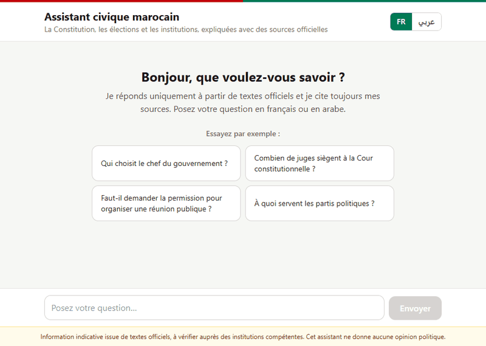
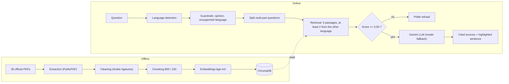
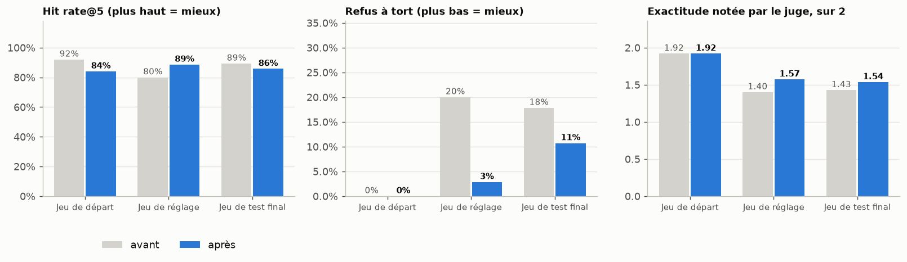
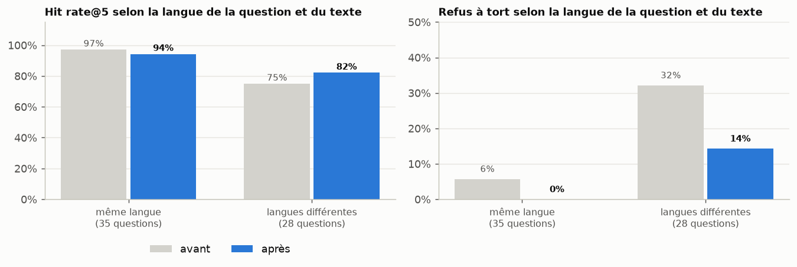
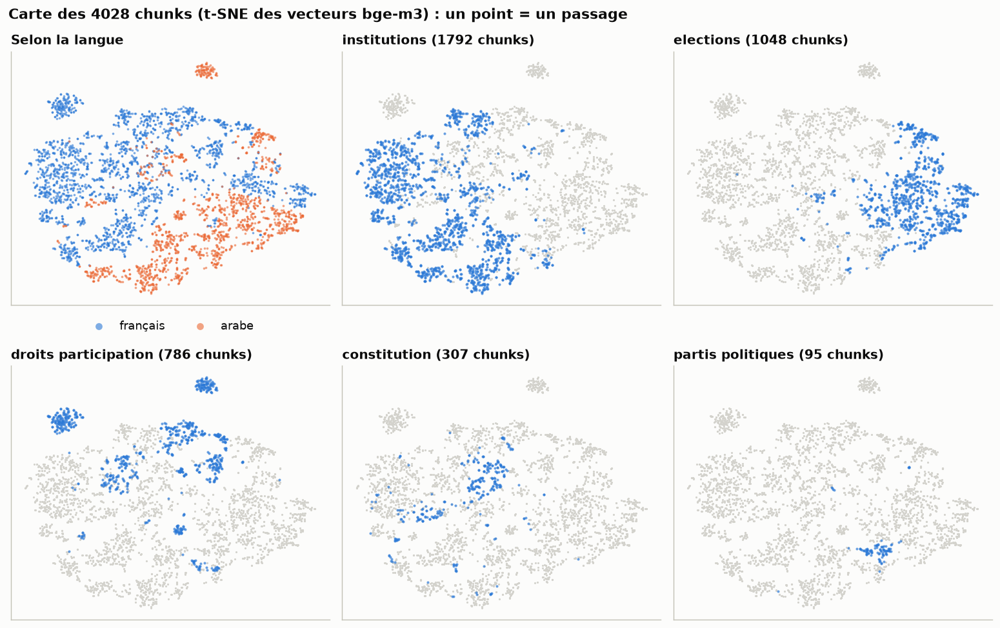
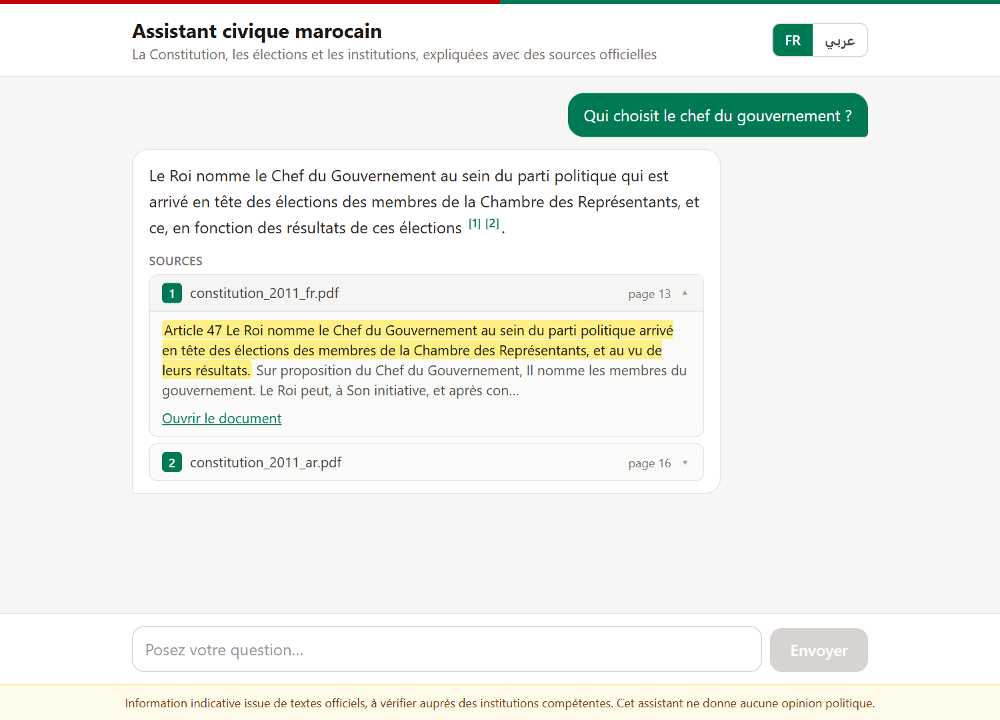
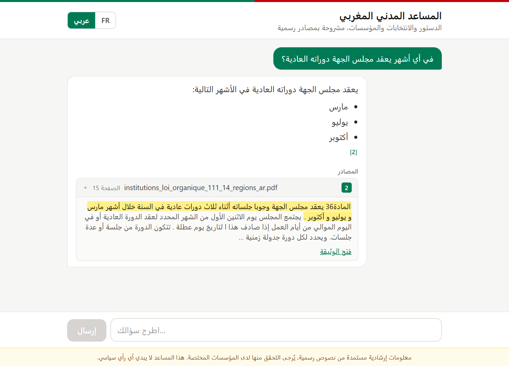
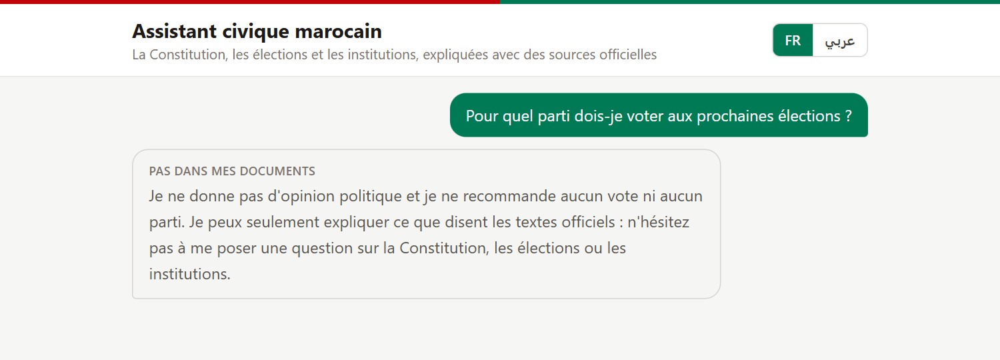
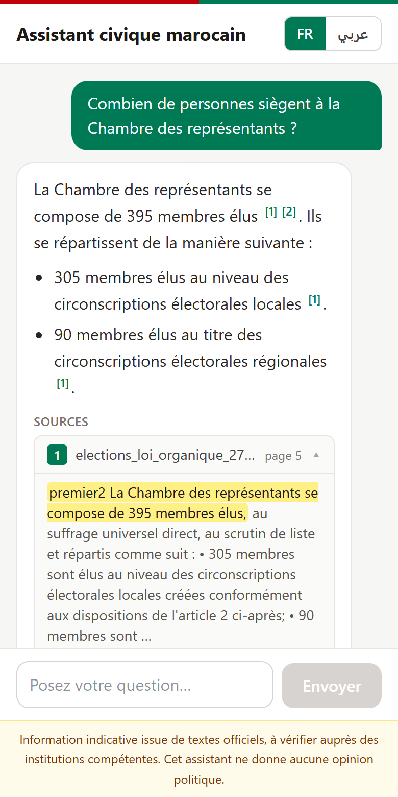

<div align="center">

# Moroccan Civic Assistant
### A bilingual (French / Arabic) RAG chatbot grounded in 35 official texts

<p>Ask about the Moroccan Constitution, elections, political parties and institutions, in French or Arabic. The assistant answers only from official documents, cites and highlights its sources, stays politically neutral, and says "I don't know" when the answer is not in the texts.</p>

<p>
  <a href="README.fr.md"></a>
  <a href="backend/notebooks/01_analyse_exploratoire.ipynb"></a>
  <a href="https://github.com/salmahanabal/Moroccan-civic-assistant/actions/workflows/ci.yml"></a>
</p>

<p>
  <a href="#results"></a>
  <a href="#results"></a>
  <a href="#results"></a>
  <a href="#corpus"></a>
  <a href="#corpus"></a>
</p>

<p>
  
  
  
  
  
  
  
  
</p>

</div>

---

## Table of contents

- [Overview](#overview)
- [Demo](#demo)
- [Highlights](#highlights)
- [How it works](#how-it-works)
- [Corpus](#corpus)
- [Results](#results)
- [Evaluation method](#evaluation-method)
- [Exploratory analysis](#exploratory-analysis)
- [The web interface](#the-web-interface)
- [API](#api)
- [Project structure](#project-structure)
- [Quality](#quality)
- [Limitations](#limitations)
- [Ideas for improvement](#ideas-for-improvement)
- [Tech stack](#tech-stack)
- [Privacy and disclaimer](#privacy-and-disclaimer)
- [Author](#author)

## Overview

Many young people cannot easily find what the law says about elections, parties or the Parliament: the texts are scattered across several official websites, written in legal language, and often available in one language only.

This project is a **retrieval-augmented generation (RAG)** system, built by hand without LangChain: it retrieves the passages of 35 official Moroccan texts that are closest to a question, then asks an LLM to answer **only** from those passages. Every answer cites its sources (document, page, the sentence that answers, link to the original). When the passages do not contain the answer, the assistant says so instead of inventing one, and it refuses to give political opinions.

The project also documents how well it works: three question sets, a hand-scored evaluation, an LLM judge validated with Cohen's kappa, an exploratory analysis of the embeddings, and a list of measured limits.

It is a **presentation repository**: code, evaluation and documentation are public, and setup instructions are intentionally not provided.

## Demo



<sub>[Watch the video at real speed](docs/demo/demo_surlignage_natif.webm) (WebM, 5.4 MB). The project is not hosted online: the demo was recorded from a local run.</sub>

The demo shows a French question with numbered sources, a click that unfolds the source and highlights the sentence that answers (Article 47 of the Constitution), the link to the official site, the same in Arabic with a right-to-left interface, and a polite neutral refusal to an opinion question.

## Highlights

- **Verifiable sources.** Each answer shows the document, the page, an excerpt with the answering sentence highlighted, and a link to the original (PDFs open at the cited page).
- **Strict neutrality.** Opinion and voting-advice questions are refused before any LLM call (French and Arabic rules), and a strict prompt backs this up.
- **One multilingual index.** `BAAI/bge-m3` embeds French and Arabic in the same space, so a French question can find a law that exists only in Arabic. At least 2 of the 5 retrieved passages come from the other language.
- **Honest refusals.** A similarity threshold and a strict prompt make the assistant answer "not in my documents" rather than invent.
- **Multi-part questions.** A question about two topics is split into simple questions for retrieval, with a fallback if the LLM is slow.
- **Hand-written pipeline.** Extraction, cleaning (including Arabic ligature repair), chunking, embeddings, vector store, retrieval and generation are one readable function each.
- **Measured, not claimed.** Three question sets that cover all 35 documents, including a final test never used to tune the system.
- **Engineering basics.** FastAPI with validation and rate limiting, Docker image, GitHub Actions CI, 171 tests.

## How it works



**Offline (building the index).** PDFs are read page by page with PyMuPDF, cleaned (repeated headers removed, Arabic ligatures stored backwards by some PDFs repaired), cut into 800-character chunks with a 150-character overlap, embedded with `bge-m3` (1,024-dimension vectors) and stored in ChromaDB: 4,028 chunks from 1,293 pages.

**Online (one question).**

1. The language is detected and two cases are refused at once, without using any LLM quota: requests for a political opinion and unsupported languages (English).
2. If the question looks multi-part, an LLM splits it into up to 3 simple questions, **only for retrieval**. It never sees any passage, and the call is capped at 8 seconds.
3. Retrieval returns the 5 closest chunks, with a **guaranteed minimum of 2 from the other language**: if the best chunks are all in the question's language, the best chunks of the other language replace the last ones; if the other language is already well represented, nothing is capped.
4. If even the best chunk scores under 0.50, the assistant refuses without calling the LLM.
5. Otherwise Gemini receives the question, the numbered passages and strict rules (use only the passages, cite them, stay neutral, read passages in the other language, answer the part of the question that can be answered). A list of fallback models handles the free-tier daily quotas.
6. Only the passages actually cited are returned. For each one, the sentence sharing the most words and numbers with the answer is highlighted.

## Corpus

**35 official documents** (20 in French, 15 in Arabic) collected between 18 and 25 October 2026; 62 % of the chunks are French, 38 % Arabic.

| Theme | Documents (FR / AR) | Content |
|---|---|---|
| Constitution | 2 (1 / 1) | Constitution of 2011 |
| Elections | 8 (2 / 6) | organic laws on the two chambers and on local elections, electoral lists law and its amendment, decree on the electoral lists website |
| Political parties | 2 (0 / 2) | organic law 29-11, decree on public funding |
| Institutions | 11 (9 / 2) | organic laws on prefectures, communes, regions, the finance law, the Constitutional Court, the government, parliamentary inquiry committees, the CESE; laws on the integrity authority and the Mediator; rules of procedure of the House of Representatives |
| Rights and participation | 12 (8 / 4) | petitions, legislative motions, strike, Amazigh language, associations, public assemblies, access to information, the CNDH, the youth council, the parity authority, press law, a guide on open government |

Sources: Ministry of Justice (Adala portal, 22 documents), General Secretariat of the Government (6), House of Representatives (5), Ministry of the Interior (2). The full register is in [`data/sources.csv`](data/sources.csv). **The PDFs are not redistributed** because the reuse conditions of the source websites are not specified.

## Results

The final system (35 documents, `bge-m3`, at least 2 passages of the other language, question splitting, corrected prompt) was measured on **three question sets, before and after a round of fixes**. Accuracy and faithfulness are rated by an LLM judge for all three sets so that "before" and "after" are comparable.

| Question set | System | Hit rate@5 | Correct refusals (off-topic) | Wrongful refusals | Accuracy (judge, 0–2) | Faithfulness (judge) |
|---|---|---|---|---|---|---|
| Starting set (30 questions) | before → after | 92 % → 84 % | 5/5 → 5/5 | 0 % → 0 % | 1.92 → 1.92 | 30/30 → 30/30 |
| Tuning set (45 questions) | before → after | 80 % → **89 %** | 10/10 → 10/10 | 20 % → **3 %** | 1.40 → **1.57** | 44/45 → 45/45 |
| **Final test set (36 questions)** | before → after | 89 % → 86 % | 8/8 → 8/8 | 18 % → **11 %** | 1.43 → **1.54** | 36/36 → 36/36 |

The starting set and the tuning set were used to find and fix flaws; the **final test set** was written before any fix and measured once with the corrected system. A wrongful refusal is the assistant answering "not in my documents" when the answer exists.

- **Wrongful refusals dropped**: 20 % → 3 % on the tuning set and 18 % → 11 % on the final test (5 → 3 of 28 questions).
- **Judge-rated accuracy rose slightly**: 1.40 → 1.57 (tuning) and 1.43 → 1.54 (final test).
- **No new invented answers**: all 23 off-topic questions are still refused.
- **Retrieval did not improve reliably**: hit rate@5 went up on the tuning set, down by one question on the final test, and down on the starting set (the set the first version had been tuned on).
- **A language gap remains.** Over the three sets, after the fixes: when the question and the text are in the **same language** (35 questions), 94 % of the right documents are found and 0 % of the answers are wrongful refusals; when the **languages differ** (28 questions), 82 % and 14 %. On the final test alone, wrongful refusals on cross-language questions stayed at 3 of 15, so that part of the improvement is established on the tuning sets but not confirmed by the final test.

All sets are small (28 to 35 in-corpus questions each): a difference of one or two questions is within noise.





## Evaluation method

- **Starting set** (30 questions written at the beginning): 25 in-corpus (simple, combined, Arabic) and 5 off-topic. It tuned the first version and is the one scored by hand (average accuracy 1.92 / 2 for the first version).
- **Tuning set** (45 questions): aimed at the 24 documents the starting set ignored, written from the texts before seeing any answer. It first served as a fresh test, then to find and fix the flaws.
- **Final test set** (36 questions): written before any fix, 15 of its 28 in-corpus questions deliberately cross the language of the question and of the text.
- Together, the three sets cover **all 35 documents**. Each question comes with an expected answer, the expected document(s), the page and the excerpt, **found automatically in the texts**.
- **Metrics**: hit rate@5 (the right document is among the 5 retrieved passages), correct refusal, wrongful refusal, accuracy (0 = wrong or refused, 1 = partial, 2 = correct and complete), faithfulness (0 only if the answer contains something absent from the cited passages), latency.
- **LLM judge and Cohen's kappa.** A free-tier Gemini model rates the same answers with the same grid. Before I revised one of my own scores after seeing a disagreement, agreement was 24/25 with **kappa 0.65**; after the revision it is 25/25 (kappa 1.00) but no longer independent of the judge, so 0.65 is the figure to quote. **28 deliberately bad answers** (another question's answer, a changed number, an invented sentence, a wrongful refusal) were all caught (28/28), although these are blatant defects.

The full evaluation (configuration comparisons, error analysis, excerpt study) is in the [French README](README.fr.md#évaluation).

## Exploratory analysis

The notebook [`01_analyse_exploratoire.ipynb`](backend/notebooks/01_analyse_exploratoire.ipynb) (outputs included, 12 figures) examines the data before judging the chatbot.

- **Healthy extraction**: median chunk length around 700 characters, 2 chunks under 200 characters, no "glued" Arabic letters, 8 exact duplicates out of 4,028.
- **Language structures the embedding space more than topic**: silhouette 0.071 by language against 0.022 by theme (0.072 on the Constitution alone, where both languages say the same thing). Both values are low.
- **The top-5 passages follow the question's language**: 84 % are French for a French question (the corpus is 62 % French) and 80 % are Arabic for an Arabic question (38 % of the corpus). This is why a minimum of passages from the other language is guaranteed.
- **No refusal threshold separates the questions**: the lowest in-corpus question scores 0.530 and the highest off-topic one 0.650, so refusal relies on a low threshold (0.50) combined with the LLM's own refusal.



## The web interface

| French answer, source unfolded | Arabic answer (right-to-left layout) |
|---|---|
|  |  |
| **Neutral refusal to an opinion question** | **On a phone** |
|  |  |

The interface is a React application (Vite + Tailwind CSS). It contains no AI logic: it sends the question to the API and displays the answer, the sources and a permanent disclaimer, in French or Arabic.

## API

| Method | Route | Purpose |
|---|---|---|
| `GET` | `/health` | the API is up and the index contains chunks |
| `POST` | `/chat` | answers a question with its sources |

The body of `/chat` is a `question` (1 to 500 characters) and an optional `theme` to limit the search. Errors: `422` for an empty or too long question, `429` above 10 requests per minute per IP address, `503` with a readable message when the LLM is unavailable. A real response (excerpt shortened):

```json
{
  "answer": "Le Roi nomme le Chef du Gouvernement au sein du parti politique arrivé en tête des élections des membres de la Chambre des Représentants, et au vu de leurs résultats [1].",
  "language": "fr",
  "found": true,
  "sources": [
    {
      "id": 1,
      "file": "constitution_2011_fr.pdf",
      "page": 13,
      "excerpt": "Article 47 Le Roi nomme le Chef du Gouvernement au sein du parti politique arrivé en tête des élections des me…",
      "highlight_start": 0,
      "highlight_end": 177,
      "url": "https://www.chambredesrepresentants.ma/fr/la-constitution-du-royaume-du-maroc-2011",
      "score": 0.655
    }
  ]
}
```

`found` is `false` for a polite refusal, and `highlight_start` / `highlight_end` frame the answering sentence inside `excerpt` (`null` when none stands out).

## Project structure

```
.
├── backend/
│   ├── main.py                  FastAPI API (/health, /chat)
│   ├── schemas.py               input and output formats (Pydantic)
│   ├── src/                     RAG pipeline: ingest, cleaning, chunking, embeddings, vectorstore,
│   │                            retriever, query_rewriter, generator, prompts, guards, excerpt, rag
│   ├── evaluation/              3 question sets, results, LLM judge, negative controls, before/after comparison
│   ├── notebooks/               exploratory analysis and figures
│   ├── tests/                   171 pytest tests
│   └── Dockerfile
├── frontend/                    React interface (Vite, Tailwind)
├── data/sources.csv             register of the 35 documents (the PDFs are not published)
├── docs/demo/                   demo as GIF and video
├── screenshots/                 interface screenshots
├── docker-compose.yml
└── .github/workflows/ci.yml     continuous integration
```

## Quality

- **171 pytest tests** covering extraction, cleaning (including Arabic repair), chunking, the vector store, question splitting, excerpt selection, guardrails, the generator, orchestration, the API and the evaluation tools. They never call the real LLM or the real embedding model: both are replaced by fake functions.
- **GitHub Actions** runs on every push: backend tests, frontend lint and build, then a Docker image build with a start-up check on `/health`.
- **No secret in Git**: the API key lives in an ignored `.env` file, and the CI uses a dummy key.
- **Readable code**: one function per step, comments in French, variable and function names in English.

## Limitations

- **Performance gap by language of the text.** The assistant answers in the question's language whatever the language of the text (24 of the 28 cross-language questions get an answer), with somewhat lower reliability: wrongful refusals are 14 % (4 of 28) when the languages differ against 0 % (0 of 35) when they are the same, and hit rate@5 is 82 % against 94 %. This is expected from a multilingual embedding model, which first brings together texts in the question's language.
- **Questions that need two texts** are rarely solved (0 of 2 on the final test, 2 of 4 on the tuning set).
- **Refusal threshold**: no threshold separates in-corpus from off-topic questions (0.530 against 0.650), so refusal relies on a low threshold combined with the LLM's refusal.
- **Link to the Constitution**: "Open the document" leads to the home page of the text (a web page with one address for the whole document), not to the cited article.
- **Small question sets**: one or two questions of difference is within noise, and the tuning and final-test scores come from an LLM judge, not from a person.
- **Corpus**: mostly legal texts, harder to read than teaching guides; only 2 documents on political parties, both in Arabic; some texts may have been amended since collection; some Arabic PDFs keep extraction defects that cleaning does not repair.
- **Free LLM tier**: quotas per model and per day, one reason the project is not hosted publicly.
- **Scope**: no conversation memory, and English is not supported (polite refusal).

## Ideas for improvement

- Translate or rephrase the question into the other language before retrieval (one more LLM call per question, not tried), or compare sentence-level vectors, then measure on a **fourth question set** (the final test set must no longer be used for tuning).
- Add a reranker and a keyword search alongside the vector search, and try 1,200-character chunks with `bge-m3` (only tried with `e5-base`).
- Have a person score a sample of the tuning-set and final-test answers by hand, to validate the LLM judge on those sets.
- Add conversation memory and English support.

## Tech stack

Python 3.11, PyMuPDF, sentence-transformers (`BAAI/bge-m3`), ChromaDB, Gemini API (REST), FastAPI, Pydantic, slowapi, React, Vite, Tailwind CSS, Docker, GitHub Actions, pytest, pandas, scikit-learn, matplotlib, Jupyter.

## Privacy and disclaimer

Answers are **indicative**, drawn from official texts, and may be out of date: check with the competent institutions. The assistant gives no personalised legal advice and **no political opinion**. The text of the questions is never written to the API logs.

Sources: Ministry of Justice (Adala portal), General Secretariat of the Government, House of Representatives, Ministry of the Interior (electoral lists portal). The reuse conditions of these websites are not specified, which is why the documents are not redistributed here.

## Author

<table>
  <tr>
    <td align="center"><a href="https://github.com/salmahanabal"><b>Salma Hanabal</b></a><br><sub>@salmahanabal</sub></td>
  </tr>
</table>
